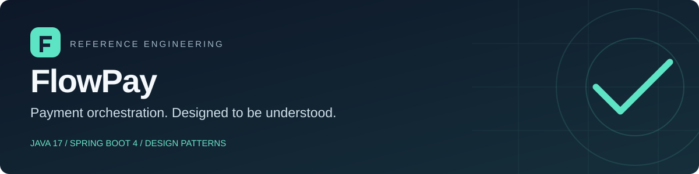

# FlowPay

A small payment-authorization API that makes design patterns visible through a concrete problem: **how do you validate a payment, choose its processor and handle a client retry without authorizing it twice?**

Built for the DIO Java/Spring Design Patterns challenge. The implementation favors explicit boundaries and readable code over a large feature set.

**Java 17 · Spring Boot 4.1.1 · Maven Wrapper · JUnit 5 · JaCoCo · MIT**

[Architecture](docs/architecture.md) · [API contract](docs/openapi.yaml) · [HTTP examples](docs/requests.http) · [Verification](docs/quality-report.md) · [Guia em português](docs/guia-pt-br.md)

> This is an educational reference, not a payment platform. AsterPay is a fictional, in-process provider. No funds move. State is in memory, and the service has no authentication. Use synthetic data and run it locally.

## What the API does

- Authorizes PIX, tokenized credit-card and bank-transfer requests through separate strategies.
- Applies ordered business rules for amount, currency and payment method.
- Reserves an idempotency key before processing; concurrent requests with the same valid payload share one receipt.
- Returns a conflict when a retained key is reused with a different valid payload.
- Exposes immutable receipts, structured errors, correlation IDs, health and a payment-request counter.

The simulated provider approves valid requests, except for the fixture token `tok_declined`, which produces a `DECLINED` receipt. An authorization decision is not a settlement or a ledger entry.

## Run locally

Requirements: a **JDK 17 or newer** and an internet connection for the first dependency download. Maven 3.9.11 is pinned by the wrapper; a separate Maven installation is not required. The verified baseline is JDK 17.

```bash
git clone https://github.com/ricciarellidev/flowpay-design-patterns.git
cd flowpay-design-patterns
bash ./mvnw --batch-mode --no-transfer-progress clean verify
java -jar target/flowpay-1.0.0.jar
```

On Windows, use `mvnw.cmd clean verify` instead of `bash ./mvnw ...`.

The API listens on `http://localhost:8080`, bound to loopback by default. Confirm startup:

```bash
curl --fail http://localhost:8080/actuator/health
```

Expected status: `UP`. A source-only checkout does not contain a prebuilt JAR; the `verify` command creates it.

### Optional container workflow

```bash
docker compose up --build
```

The multi-stage image verifies the project before packaging it and runs the application as a non-root user. Compose publishes the port on host loopback only. The container configuration is supplied for convenience; Docker execution was not available in the recorded verification environment. The Java build and HTTP tests were executed directly. See [verification scope](docs/quality-report.md).

## Try a payment and a retry

```bash
curl --include --request POST http://localhost:8080/api/v1/payments \
  --header 'Content-Type: application/json' \
  --header 'Idempotency-Key: order_demo_001' \
  --header 'X-Correlation-Id: local_demo_001' \
  --data '{"customerId":"customer_demo","amount":125.90,"currency":"BRL","method":"PIX"}'
```

The first request returns `201 Created`, a `Location` header and `Idempotent-Replayed: false`. Repeat the command unchanged: the response is `200 OK`, `Idempotent-Replayed: true`, and the receipt is unchanged. Change `amount` while keeping the key: a valid changed request returns `409 Conflict`.

Example receipt; IDs and timestamps are illustrative:

```json
{
  "id": "57d154c5-4d23-419c-9bc1-333224635d10",
  "customerId": "customer_demo",
  "amount": 125.90,
  "currency": "BRL",
  "method": "PIX",
  "status": "APPROVED",
  "providerReference": "aster_e14f7e11-5db8-42a3-9f39-bf89499bf43d",
  "processedAt": "2026-10-09T12:00:00Z"
}
```

Fetch the returned receipt with `GET /api/v1/payments/{id}`. Request tokens and descriptions are not included in the response. Ready-to-run card, decline and validation examples are in [requests.http](docs/requests.http).

## The patterns, without name-dropping

| Pattern | Where to look | What it buys here |
|---|---|---|
| Strategy | [`PaymentProcessor`](src/main/java/dev/ricciarelli/flowpay/domain/service/PaymentProcessor.java) | Method-specific routing without a processor switch in orchestration. |
| Chain of Responsibility | [`PaymentValidationChain`](src/main/java/dev/ricciarelli/flowpay/domain/validation/PaymentValidationChain.java) | Ordered, independently testable rules that stop at the first rejection. |
| Adapter | [`AsterPayGatewayAdapter`](src/main/java/dev/ricciarelli/flowpay/infrastructure/gateway/AsterPayGatewayAdapter.java) | Translates exact decimal amounts and provider status into the domain model. |
| Observer | [`PaymentEventListener`](src/main/java/dev/ricciarelli/flowpay/infrastructure/gateway/PaymentEventListener.java) | Keeps request metrics and receipt logs outside the use case. |
| Repository | [`PaymentRepository`](src/main/java/dev/ricciarelli/flowpay/domain/port/PaymentRepository.java) | Keeps retrieval independent of the in-memory storage adapter. |

The processor registry selects existing strategies; it is not described as GoF Factory Method. Spring bean scope is not used to claim a custom Singleton implementation. [Design notes](docs/architecture.md) explain these choices and their limits.

## Contract at a glance

| Request | Result |
|---|---|
| `POST /api/v1/payments` + new valid key/payload | `201` and a new receipt |
| Same key + equivalent valid payload | `200` and the original receipt |
| Same retained key + different valid payload | `409` Problem Detail |
| `GET /api/v1/payments/{id}` | `200` receipt, or `404` |
| Invalid syntax, field or header | `400` Problem Detail |
| Valid syntax but rejected business rule | `422` Problem Detail |
| Unexpected server failure | `500` sanitized Problem Detail |

`Idempotency-Key` must contain 8–64 letters, digits, underscores or hyphens. Amounts are positive with at most two decimal digits; the default maximum is `100000.00`. BRL, USD and EUR are supported, but PIX requires BRL. Card requests require a fictional `tok_...` token. Do not enter card numbers.

Errors follow RFC 9457 and carry a stable `code` plus `correlationId`. The [OpenAPI 3.1 contract](docs/openapi.yaml) describes the fields, headers and responses; it is a checked-in contract, not a runtime Swagger UI.

## Tests and observability

`clean verify` runs unit tests, real HTTP integration tests on a random port, builds an executable JAR and checks coverage. The JaCoCo gate requires **90% line coverage and 80% branch coverage** on the explicitly scoped implementation. DTOs, configuration and the bootstrap class are excluded from those ratios and covered indirectly by HTTP tests.

The recorded results and exclusions are in [quality-report.md](docs/quality-report.md). Local reports are generated under `target/site/jacoco/index.html`; test results are under `target/surefire-reports/`. The same verification command runs in [GitHub Actions](.github/workflows/ci.yml). A local green build is not presented as a completed remote CI run.

```bash
curl http://localhost:8080/actuator/metrics/flowpay.payments.processed
```

This counter includes handled replays. It measures payment requests, not revenue or settled charges. Correlation IDs are returned in `X-Correlation-Id` and included in logs; unsafe incoming values are replaced.

## Read the implementation

Start with [`PaymentService`](src/main/java/dev/ricciarelli/flowpay/application/PaymentService.java), then follow the validation chain, processor registry and gateway port. Read [`InMemoryIdempotencyStore`](src/main/java/dev/ricciarelli/flowpay/infrastructure/persistence/InMemoryIdempotencyStore.java) alongside its [concurrency test](src/test/java/dev/ricciarelli/flowpay/infrastructure/persistence/InMemoryIdempotencyStoreTest.java).

| Package | Responsibility |
|---|---|
| `domain` | JDK-only values, rules, strategies and ports |
| `application` | Coordinates a use case and publishes its local event |
| `infrastructure` | Simulated provider, storage adapters and listener |
| `web` | HTTP validation, DTOs, headers and error representation |
| `config` | Dependency composition and typed settings |

The application layer uses Spring's event publisher; this is an intentional framework boundary, not a claim that the whole project is framework-independent.

## Constraints worth knowing

Idempotency is local to **one running JVM**. Both stores have no capacity bound or expiry and lose data on restart. There is no authentication, tenant isolation, database, real provider, durable event delivery, settlement or refund flow. A provider success followed by a storage failure would need reconciliation in a real system.

Do not scale this version horizontally or expose it publicly with customer data. [Architecture](docs/architecture.md) and [SECURITY.md](SECURITY.md) describe the work needed before a production integration. Coverage is useful evidence, not a guarantee of correctness or security.

## Challenge and attribution

This repository provides an original implementation for the DIO Design Patterns challenge rather than copying a class example. [The Portuguese guide](docs/guia-pt-br.md) maps the submission to the challenge and provides a short delivery description.

References: [DIO Java patterns](https://github.com/digitalinnovationone/lab-padroes-projeto-java), [DIO Spring patterns](https://github.com/digitalinnovationone/lab-padroes-projeto-spring), [Spring Boot](https://docs.spring.io/spring-boot/), [Java 17 API](https://docs.oracle.com/en/java/javase/17/docs/api/), [RFC 9457](https://www.rfc-editor.org/rfc/rfc9457.html).

MIT licensed. See [LICENSE](LICENSE).

For a source-archive handoff, `sha256sum --check FILES.sha256` verifies the delivered file bytes before publication. The manifest excludes itself and generated build output. It is a delivery snapshot; regenerate it if source files are intentionally changed.
