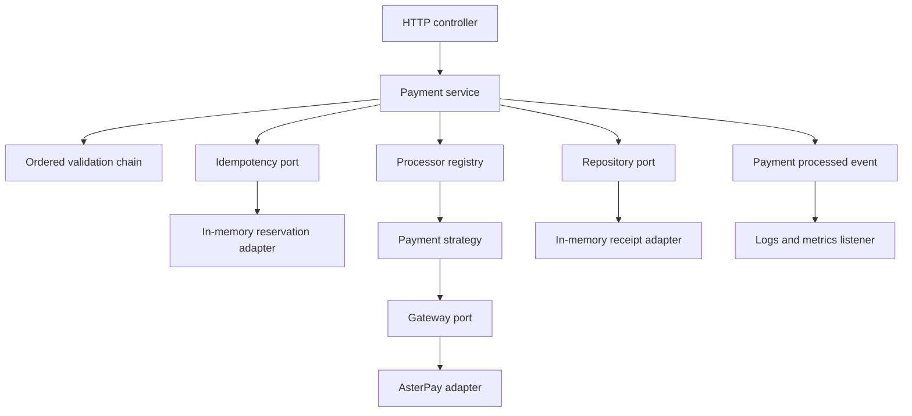
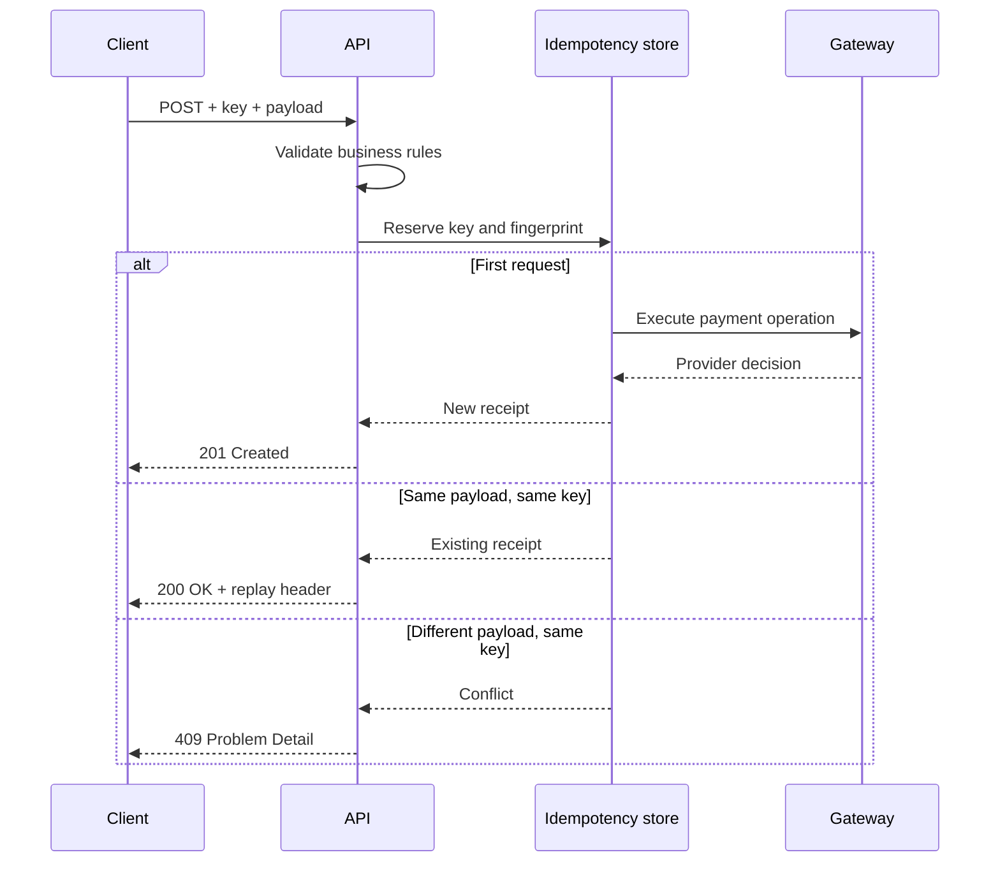

# Design notes

## Scope and boundaries

FlowPay is a reference implementation of a payment-authorization workflow. It is not a payment service provider. The fictional AsterPay SDK runs entirely inside the process; no network request reaches a bank or card network.

The service accepts a payment request, validates it, selects the appropriate processor and returns an immutable receipt. Repeated requests with the same idempotency key return that receipt without a second provider call. A changed payload with that key is a conflict.

The domain uses only the JDK. Spring assembles the objects in `ApplicationConfiguration`, exposes HTTP endpoints and supplies observability. HTTP DTOs and the provider's SDK types stay outside the domain.

## Why these patterns

| Pattern | Concrete use | Reason for the boundary |
|---|---|---|
| Strategy | `PaymentProcessor` and its three implementations | Each method owns its provider channel; orchestration does not select channels with conditionals. |
| Chain of Responsibility | `PaymentValidationChain` | Ordered handlers reject the request at the first failing rule. A rule can be added without editing the service. |
| Adapter | `AsterPayGatewayAdapter` | Provider-specific minor-unit amounts and status strings never leak into the application contract. |
| Observer | `PaymentProcessedEvent` / `PaymentEventListener` | Metrics and audit-style logs are separate from orchestration. The event includes replay information. |
| Repository | `PaymentRepository` | Retrieval and persistence depend on a port instead of a concrete collection. |

`PaymentProcessorRegistry` is a small selection registry, not a claimed GoF Factory Method. It is deliberately explicit about duplicate registration and missing implementations. Spring's default bean scope is not presented as an implementation of the GoF Singleton pattern.

## Request sequence

## Decision 1: money is decimal, never floating point

Amounts use `BigDecimal`. HTTP validation accepts positive values with at most two decimal digits, and the domain enforces the maximum independently. Only BRL, USD and EUR are enabled, all with two minor-unit decimal places. The adapter converts the amount to an exact `long` value without silent rounding.

Supporting a zero-decimal or three-decimal currency requires a deliberate change to precision validation and minor-unit conversion. Merely adding it to configuration would not be sufficient.

## Decision 2: local idempotency, with a clear guarantee

A `ConcurrentHashMap` reserves keys atomically with `putIfAbsent`. The winning request owns a `CompletableFuture`; other requests with the same fingerprint await its result. Different keys can proceed independently. No global lock surrounds provider processing.

The fingerprint is a SHA-256 digest of length-prefixed fields. This prevents delimiter collisions and avoids storing the raw instrument token in the idempotency cache. Equivalent decimal representations produce the same fingerprint. Description is included; omitted and empty optional values are treated equivalently.

The guarantee is limited to one running JVM and its retained state. Entries have no TTL or capacity bound in this educational implementation. State is lost on restart. A provider-side success followed by a persistence failure cannot be safely resolved by this local store. Clearing failed reservations is only valid for the simulated, side-effect-free provider.

A real integration would require provider idempotency, durable reservations, a reconciliation state machine, bounded retention and recovery for ambiguous outcomes. “Exactly once” across distributed systems is not claimed here.

## Decision 3: events are synchronous and local

The listener records a `flowpay.payments.processed` counter with bounded method/status/replay tags. Replays count as handled requests; they do not represent additional charges. Logs contain the receipt ID, method and status, not customer details or tokens.

Events are not durable. There is no queue, outbox or delivery guarantee. A production workflow would need a transactional outbox and consumers that tolerate duplicate delivery.

## Decision 4: a small surface area

There are two business endpoints: create/authorize and fetch by ID. This keeps the design-pattern exercise focused. Settlement, refunds, ledger entries, card-number handling and user accounts are outside scope.

Errors follow RFC 9457 using Problem Detail. Invalid HTTP inputs return 400; business-rule rejection returns 422; a conflicting idempotency payload returns 409. A provider decline is a valid business outcome and creates a receipt with status `DECLINED`.

## Security posture

The reference service has no authentication or tenant isolation. Idempotency keys are global to the process. Do not deploy it publicly with actual customer data. Accepted correlation IDs are allowlisted to prevent control characters and arbitrary content in logs. Errors do not echo raw request bodies, provider tokens or stack traces to the client.

The Java process binds to loopback by default. Inside the Docker image, it binds to the container interface; Compose publishes that port on host loopback only. The Docker runtime runs as a non-root user. Actuator exposes health, info and metrics only, but these still require appropriate network controls before any public deployment.

## Extension exercise

To introduce a new payment method:

1. Add the method to the domain enum and document its currency/token rules.
2. Implement `PaymentProcessor` and register it in the composition root.
3. Add or extend a validation handler only if the new method needs different policy.
4. Cover routing, validation, declines and replay behavior in tests.
5. Update the OpenAPI contract and HTTP examples.

This is intentionally not a plugin system: public API changes remain explicit and reviewable.
